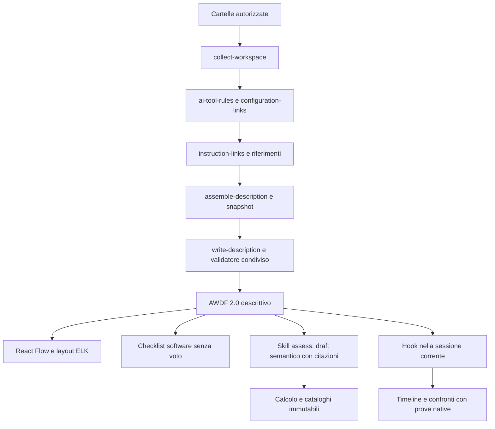

# Architettura del classificatore 2.0

Il coordinatore `scripts/lib/describe-workspace.mjs` gestisce impostazioni, cache di lettura, riconoscimento delle componenti e invocazione delle fasi. La raccolta, il riconoscimento dei profili, l'analisi delle istruzioni, l'assemblaggio e la scrittura sono moduli distinti. `src/evaluator/validate.js` è condiviso da CLI e browser; l'integrità usa snapshot e citazioni.

`src/evaluator/assessment.js` valida il giudizio semantico e calcola punteggi ricalcolabili. `catalog-registry.js` conserva versioni immutabili; l'aggiornamento è esplicito. I criteri sono raccomandazioni progettuali derivate da fonti, separati dai requisiti di riconoscimento dei client.

`src/runtime/adapters.js` normalizza hook nativi dei tre client; `scripts/lib/recorder.mjs` isola sessioni, registra eventi separati per evitare collisioni, redige e finalizza. `src/runtime/report.js` confronta le prescrizioni con prove positive e mantiene non verificabili le conclusioni senza evidenza. Le review semantiche sono marcate separatamente dalle prove native. Non raccoglie ragionamenti nascosti né valuta la qualità dell'output.

La mappa usa relazioni con semantica esplicita. Il documento descrittivo non incorpora valutazioni o run: ogni artefatto ha riferimenti report/snapshot/tool/task. L'importazione verifica questi riferimenti prima di cambiare lo stato.

## Limiti e lavoro ulteriore

La cattura del filesystem non è atomica. Parser incompleti e fonti escluse sono dichiarati; la redazione rimane best effort. Gli hook non osservano ogni percorso del client: anche una run terminata può avere copertura parziale. Le versioni dei client possono cambiare i payload, quindi occorre verificarle in sessioni reali. I test degli adattatori con fixture non sostituiscono questa verifica.

Per consolidare il progetto: ampliare le prove native supportate, aggiungere fixture da sessioni reali redatte e mantenere fonti e profili aggiornati con nuove versioni. Non reintrodurre conversioni o fallback dei formati precedenti.
